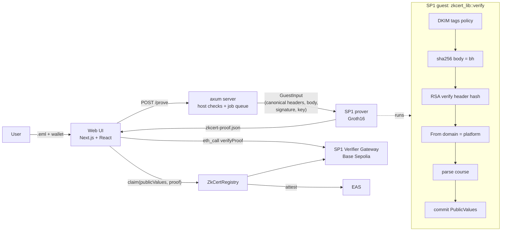

# zkCert (SP1)

Prove "I completed course X on Coursera or Udemy" from the platform's **DKIM-signed completion email**,
with an SP1 zero-knowledge proof. The email, your email address and your name stay private. Anyone can
verify the proof file, and you can optionally record it on-chain as an EAS attestation.

No zkTLS is involved. The source of truth is the DKIM signature the platform's mail server already
puts on every email.

Design: [docs/ARCHITECTURE.md](docs/ARCHITECTURE.md) · email findings: [docs/PHASE1_FINDINGS.md](docs/PHASE1_FINDINGS.md) · decisions and pinned versions: [docs/DECISIONS.md](docs/DECISIONS.md) · demo script: [docs/DEMO.md](docs/DEMO.md)

## Why
Fai needs verified, bot-free experts with private profiles. A certificate screenshot or PDF is easy to
forge, and neither platform signs its certificates. Both platforms do sign their completion emails:

| | Coursera | Udemy |
|---|---|---|
| Email | "Congratulations, Your Certificate is Ready!" | `Your completion certificate is ready for "<course>"` |
| DKIM signer (`d=`) | `t.mail.coursera.org` (sent via SparkPost) | `e.udemymail.com` (sent via SendGrid) |
| Key | RSA-1024 | RSA-2048 |
| Course name from | signed text/plain body (two phrases that must agree) | signed Subject |
| Date | DKIM `t=` (rounded down to the day) | none signed, so `0` |

## Architecture


**Public values** (ABI-encoded, see `lib/src/lib.rs`):
- `platform`: 1 = Coursera, 2 = Udemy.
- `courseHash`
- `courseName`: empty unless the user chooses to disclose it.
- `completedAt`
- `dkimKeyHash`: keccak256 of the signing key, which verifiers check against an allowlist.
- `nullifier`: keccak256 of ("zkcert-v1", platform, courseHash, keccak256 of the lowercased To address).
- `wallet`

## What the proof guarantees, check by check
| Check (in `lib/src/verify.rs`) | Stops | Negative test |
|---|---|---|
| RSA-SHA256 signature over the canonical signed headers | edited Subject/From/To, wrong key | `edited_subject_is_rejected`, `wrong_key_is_rejected` |
| `sha256(body) == bh=` | edited body (course name) | `edited_body_is_rejected` |
| `a=rsa-sha256`, `v=1`, valid `c=`, `x= > t=` | downgrade and unsupported signatures | `unsupported_tag_values_are_rejected`, `expiry_before_signing_time_is_rejected` |
| no `l=` tag (not even `l=0`) | appending unsigned content to the body | `l_tag_is_rejected` |
| `d=` is coursera.org / udemy.com / udemymail.com (label boundary) | ESP signatures (sendgrid.info), lookalike domains | `foreign_signing_domain_is_rejected` |
| `i=` within `d=` | identity outside the signing domain | `identity_tag_variants` |
| `h=` signs From, Subject, To (and Content-Type for Coursera) | unsigned headers being trusted; a prover-chosen MIME boundary | `unsigned_required_headers_are_rejected`, `coursera_content_type_must_be_signed_with_boundary` |
| exactly one signed From / Subject / To, each with one mailbox | header duplication (DKIM signs bottom-up) | `duplicate_signed_from_is_rejected`, `duplicate_signed_subject_or_to_is_rejected` |
| signed fields follow `h=` order; the last field is DKIM-Signature with an empty `b=` | parse ambiguity in the hash input | `fields_out_of_h_order_are_rejected`, `last_field_must_be_dkim_signature` |
| From domain matches the `d=` platform | a Coursera key used to vouch for another sender | `from_of_other_platform_is_rejected` |
| exact certificate subject; anchor phrases appear exactly once; exactly one text/plain part | other platform emails, text injected through a user-controlled profile name | `other_platform_emails_are_rejected`, `injected_course_claim_is_rejected`, `coursera_two_text_parts_are_rejected` |
| key ≥ 1024 bits | weak keys | `key_size_boundary` |
| *Verifier:* vkey equals the pinned program (`config/program.json`) | proofs from a modified program | `wrong_vkey_is_rejected`, `pinned_vkey_matches_program` |
| *Verifier:* `dkimKeyHash` is allowlisted **for that platform** | an attacker's own DKIM key | `test_RevertWhen_KeyNotAllowlisted`, `test_RevertWhen_KeyAllowlistedForOtherPlatform`, `key_for_other_platform_is_rejected` |
| *Verifier:* real Groth16 proof through the SP1 gateway | mock/empty proofs | `test_RevertWhen_EmptyProof`, `test_RevertWhen_GarbageGroth16Proof`, `mock_requires_flag_and_unknown_systems_are_rejected` |
| *Registry:* `msg.sender == wallet` | front-running or using someone else's proof | `test_RevertWhen_SenderIsNotBoundWallet` |
| *Registry:* nullifier unused | one certificate backing several accounts | `test_RevertWhen_NullifierReused` |

## Run it on localhost
Prerequisites:
- [SP1 6.10.0](https://docs.succinct.xyz/docs/sp1/getting-started/install): `curl -L https://sp1up.succinct.xyz | bash && sp1up`
- Rust stable
- Node 24
- Foundry
- `protoc`

```bash
git submodule update --init --recursive
cp .env.example .env            # SP1_PROVER=mock by default (instant, no real proof)
cp web/.env.example web/.env
```

**1. CLI** (put your email in `fixtures/`, which is git-ignored):
```bash
cargo run --release -- execute fixtures/your-coursera.eml --disclose        # host + guest checks, cycle count
SP1_PROVER=network cargo run --release -- prove fixtures/your-coursera.eml --wallet 0xYourWallet --disclose
cargo run --release -- verify zkcert-proof.json                             # offline Groth16 verification
cargo run --release --bin discover -- fixtures/your-coursera.eml            # inspect every DKIM signature
```

**2. Server + web UI** (two terminals):
```bash
cargo run --release -p zkcert-server        # http://127.0.0.1:8080 (SP1_PROVER from .env)
cd web && npm install && npm run dev         # http://localhost:3000
```
Generate: drop the `.eml`, paste or connect a wallet, then download `zkcert-proof.json`. Verify: drop
any proof file. With `SP1_PROVER=mock` the flow completes instantly. Verify then shows every check
passing (program vkey, Coursera/Udemy key) except "Real proof" and the on-chain Groth16 check, because a
mock bundle contains no proof.

**Real Groth16 proofs:**
- Use `SP1_PROVER=network` with `NETWORK_PRIVATE_KEY` set (Succinct Prover Network).
- Local `SP1_PROVER=cpu` runs the STARK stages on a 16 GB Apple M4, but the final Groth16 wrap is killed for lack of memory. Local Groth16 needs a machine with more RAM; SP1 recommends the network.

**3. Tests:**
```bash
cargo test -p zkcert-lib                                   # canonicalization, MIME, parsers
cargo test --release -p zkcert-script                      # guest statement (+ SP1 execute), bundles, discovery
cargo test --release -p zkcert-server                      # API flow, limits, prover failures
cd contracts && forge test -vv                             # registry logic, real SP1 gateway, deploy parsing
cd web && npm run build && npm run lint
```

**4. Optional deploy and mint (Base Sepolia):**
```bash
cd contracts
PROGRAM_VKEY=$(jq -r .vkey ../config/program.json) forge script script/Deploy.s.sol \
  --rpc-url $BASE_SEPOLIA_RPC_URL --private-key $PRIVATE_KEY --broadcast   # OWNER=0x… to set another owner
# then set NEXT_PUBLIC_REGISTRY_ADDRESS in web/.env
```

## Threat model and trust assumptions
- **Root of trust: the platform's DKIM private key.** For Coursera that key is likely held by its ESP (SparkPost), and for Udemy by SendGrid; the Udemy selector is a CNAME into SendGrid. Whoever holds the key can sign any certificate email.
- **Coursera's key is RSA-1024.** That is the RFC 8301 minimum and is weak by today's standards. Allowlisted keys have no validity window: if a key leaks, removing it from the allowlist also invalidates honest proofs made with it.
- **DNS is untrusted.** Keys are pinned in `config/dkim-keys.json`, and verifiers check `dkimKeyHash` against that list (the UI) or the registry (on-chain). Pinning also keeps old emails provable after the platform rotates its keys.
- **The prover server sees the email.** It never writes the email to disk or logs it, and drops it after proving, but you must trust the operator. Production options: prove locally with the CLI, a TEE prover, or client-side proving.
- **The proof file is a bearer artifact.** Anyone holding it can show it. Its `wallet` field binds it to an address, so an off-chain verifier should ask for a signature from that wallet. The registry enforces `msg.sender == wallet`.
- **Privacy limits:**
  - `courseHash` of a public catalogue title can be guessed, so hiding the name is weak.
  - The nullifier can be brute-forced from a candidate email address plus the course.
  - An on-chain attestation makes the wallet public.
  - `completedAt` is rounded to the day.
- **Nullifier** = hash of the platform, course and signed To address. Neither platform's email carries a certificate ID, so a user with two email addresses who receives the certificate email at both could claim twice. Gmail dot and plus aliases are not normalized.
- **Udemy course titles are not unique.** Any instructor can publish a course with any title, so the proof shows "completed a course titled X".

## Numbers
| | Coursera | Udemy | Synthetic Udemy |
|---|---|---|---|
| SP1 cycles (execute) | 2,295,589 | 467,136 | ~342,000 |
| Host check + mock bundle (server) | < 1 s | < 1 s | < 1 s |
| Local CPU proof (Apple M4, 16 GB) | STARK stages complete in ~5–7 min; Groth16 wrap OOM | same | same |
| `claim` gas, mock verifier + mock EAS | 345k | | |

**Real Groth16 fixture:** the fixture tests (`forge test`, and
`cargo test --release -p zkcert-script --test bundle -- --ignored`) skip until
`contracts/src/fixtures/groth16-proof.json` exists. To create it, run:
```bash
./target/release/zkcert synth   # only if you also re-prove; the committed key must match the fixture
SP1_PROVER=network ./target/release/zkcert prove fixtures/redacted/synthetic-udemy.eml \
  --key test._domainkey.e.udemymail.com=fixtures/redacted/synthetic-udemy.key \
  --wallet 0x1234567890123456789012345678901234567890 --out contracts/src/fixtures/groth16-proof.json
```
The fixture proves a synthetic email signed by a throwaway key. In the web Verify tab it therefore passes
the Groth16 check and fails "known key", by design.

## Next steps
- Client-side or TEE proving, so no server sees the email.
- Key validity windows in the registry, enforced with the signed `t=`.
- Salted course hashes for real name privacy.
- A certificate ID from the platform's verify URL. Neither email includes one today.
- Further platforms (edX, Google Career Certificates) via the same `Platform` table.
