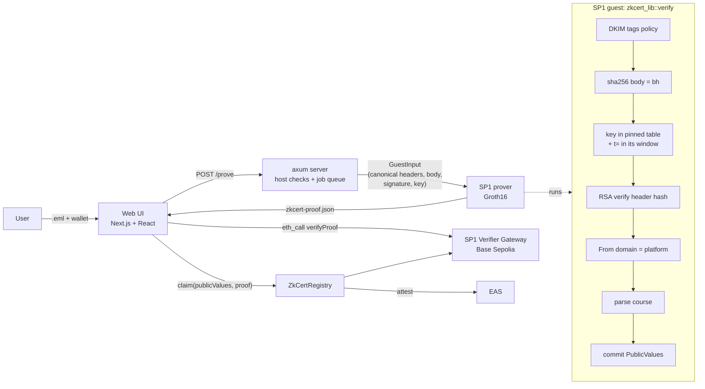

# zkCert (SP1)

Prove "I completed course X on Coursera or Udemy" from the platform's **DKIM-signed completion email**,
with an SP1 zero-knowledge proof. The email, your email address and your name stay private. Anyone can
verify the proof file, and you can optionally record it on-chain as an EAS attestation.

No zkTLS is involved. The source of truth is the DKIM signature the platform's mail server already
puts on every email.

Design: [docs/ARCHITECTURE.md](docs/ARCHITECTURE.md) · attacks and tests: [docs/ATTACKS.md](docs/ATTACKS.md) · email findings: [docs/PHASE1_FINDINGS.md](docs/PHASE1_FINDINGS.md) · decisions and pinned versions: [docs/DECISIONS.md](docs/DECISIONS.md) · demo script: [docs/DEMO.md](docs/DEMO.md)

## Why
Fai needs verified, bot-free experts with private profiles. A certificate screenshot or PDF is easy to
forge, and neither platform signs its certificates. Both platforms do sign their completion emails:

| | Coursera | Udemy |
|---|---|---|
| Email | "Congratulations, Your Certificate is Ready!" | `Your completion certificate is ready for "<course>"` |
| DKIM signer (`d=`) | `t.mail.coursera.org` (sent via SparkPost) | `e.udemymail.com` (sent via SendGrid) |
| Key | RSA-1024 | RSA-2048 |
| Course name from | signed text/plain body (two phrases that must agree) | signed Subject |
| `emailSignedAt` | DKIM `t=` (rounded down to the day) | none signed, so `0` |

## Architecture


**Public values** (ABI-encoded, see `lib/src/lib.rs`):
- `platform`: 1 = Coursera, 2 = Udemy.
- `courseHash`
- `courseName`: empty unless the user chooses to disclose it.
- `emailSignedAt`: when the platform signed the email (DKIM `t=`, day precision). This is not the
  course completion date.
- `dkimKeyHash`: keccak256 of the signing key. The guest has already checked that it is in the
  program's key table (`lib/src/keys.rs`); it is public so anyone can see which key vouched.
- `nullifier`: keccak256 of ("zkcert-v1", platform, courseHash, keccak256 of the lowercased To address).
- `wallet`

## What the proof guarantees, check by check
| Check (in `lib/src/verify.rs`) | Stops | Negative test |
|---|---|---|
| RSA-SHA256 signature over the canonical signed headers | edited Subject/From/To, wrong key | `edited_subject_is_rejected`, `wrong_key_is_rejected` |
| `sha256(body) == bh=` | edited body (course name) | `edited_body_is_rejected` |
| `a=rsa-sha256`, `v=1`, valid `c=`, `x= > t=` | downgrade and unsupported signatures | `unsupported_tag_values_are_rejected`, `expiry_before_signing_time_is_rejected` |
| no `l=` tag (not even `l=0`) | appending unsigned content to the body | `l_tag_is_rejected` |
| `d=` is coursera.org / udemy.com / udemymail.com (label boundary) | ESP signatures (sendgrid.info), lookalike domains | `foreign_signing_domain_is_rejected` |
| `i=` within `d=` | identity outside the signing domain | `identity_tag_variants` |
| `h=` signs From, Subject, To (and Content-Type for Coursera) | unsigned headers being trusted; a prover-chosen MIME boundary | `unsigned_required_headers_are_rejected`, `coursera_content_type_must_be_signed_with_boundary` |
| exactly one signed From / Subject / To, each with one mailbox | header duplication (DKIM signs bottom-up) | `duplicate_signed_from_is_rejected`, `duplicate_signed_subject_or_to_is_rejected` |
| signed fields follow `h=` order; the last field is DKIM-Signature with an empty `b=` | parse ambiguity in the hash input | `fields_out_of_h_order_are_rejected`, `last_field_must_be_dkim_signature` |
| From domain matches the `d=` platform | a Coursera key used to vouch for another sender | `from_of_other_platform_is_rejected` |
| exact subject of a known template; that template's anchor phrases appear exactly once; exactly one text/plain part | other platform emails, text injected through a user-controlled profile name | `other_platform_emails_are_rejected`, `injected_course_claim_is_rejected`, `coursera_multiple_templates`, `coursera_two_text_parts_are_rejected` |
| key ≥ 1024 bits | weak keys | `key_size_boundary` |
| key hash is in the compiled key table **for the `d=` platform** | an attacker's own DKIM key, a fake DNS answer | `production_table_rejects_unknown_key`, `guest_rejects_unknown_key`, `key_for_other_platform_is_rejected` |
| signed `t=` inside the key's validity window | use of a key by an honest signer after a future version retires it (not a leaked key: the signer chooses `t=`) | `signing_time_outside_key_window_is_rejected`, `bounded_key_requires_signing_time` |
| *Verifier:* vkey is an accepted program version (`config/program.json` `accepted`, registry `acceptedVKeys`) | proofs from a modified program (one without the key table) | `vkey_not_accepted_is_rejected`, `test_RevertWhen_VKeyNotAccepted`, `test_RevertWhen_VKeyRetired`, `pinned_vkey_matches_program` |
| *Verifier:* real Groth16 proof through the SP1 gateway | mock/empty proofs | `test_RevertWhen_EmptyProof`, `test_RevertWhen_GarbageGroth16Proof`, `mock_requires_flag_and_unknown_systems_are_rejected` |
| *Registry:* `msg.sender == wallet` | front-running or using someone else's proof | `test_RevertWhen_SenderIsNotBoundWallet` |
| *Registry:* nullifier unused (across program versions) | one certificate backing several accounts | `test_RevertWhen_NullifierReused`, `test_RevertWhen_NullifierReusedUnderNewProgramVersion` |

Every attack, with where it is enforced and its status: [docs/ATTACKS.md](docs/ATTACKS.md).

## Host-only checks and why they don't affect soundness
The guest receives already-prepared bytes (`GuestInput`): the canonical signed headers, the
canonical body, the signature and the key. Everything the host does to produce them is outside
the proof, so a malicious or buggy host must not be able to make a false statement provable.

| Host-only step | Why soundness does not depend on it |
|---|---|
| Parsing the `.eml` and choosing which DKIM-Signature to use | The guest re-parses the chosen header's tags and enforces every policy itself (`d=` platform, `v`, `a`, `l=`, `h=`, …). Choosing another signature only changes which checks fail |
| Canonicalization (`c=`, RFC 6376 §3.4) | The guest RSA-verifies and hashes exactly the bytes it is given. Wrongly canonicalized bytes don't match the signature or `bh=`, so they fail in the guest |
| Fetching the key record (pinned file or `--dns`) | The guest accepts only keys in its compiled table. Any other key, including a fake DNS answer, is rejected inside the proof |
| Key-record flags `t=y` (testing) and empty `p=` (revoked) | Decided once, when a key is added to `lib/src/keys.rs`. A revoked key is never in the table |
| "Exactly one From/Subject in the raw email" | The guest only ever sees **signed** headers, so an extra unsigned header can't reach the public values. The host check protects users from confusing emails, not the proof |
| Running `verify()` before proving | A fast copy of the guest checks for good error messages. `zkcert execute --no-host-check` skips it and the guest still rejects the same emails |

## Possession vs inbox ownership
The proof shows that **whoever made it had a genuine certificate email** and bound it to a wallet.
It does not show that this person is the learner: an `.eml` file can be forwarded as an attachment
or shared. Limits today:
- The nullifier stops one certificate from backing two accounts in the registry, but the first
  claimer wins, whoever that is.
- The To address is hidden (only its hash is inside the nullifier), so nothing ties the claim to an
  inbox the claimer controls.

**Production fix, an identity layer:**
1. Add `toCommitment = keccak(lowercase To, salt)` as a public value, where `salt` is a random
   private input the user keeps. A new program version does this. A plain `keccak(To)` would be
   dictionary-attackable and would link all of a user's certificates; the salt prevents both.
2. The user reveals the address and salt only to the verifier (Fai), which checks the commitment
   and sends a one-time code to that address.
3. The user returns the code signed with the bound wallet. This proves control of the inbox the
   course was issued to.
4. Fai stores only the link wallet ↔ `toCommitment`, not the address.

A stronger variant proves inbox control in zero knowledge too. The user replies from that inbox,
and a second SP1 proof checks the reply's DKIM signature from their mail provider (for example
Gmail's `d=gmail.com`), that it contains the wallet address, and that its From opens the same
commitment. Fai then never learns the address at all.

## Run it on localhost
Prerequisites:
- [SP1 6.10.0](https://docs.succinct.xyz/docs/sp1/getting-started/install): `curl -L https://sp1up.succinct.xyz | bash && sp1up`
- Rust stable
- Node 24
- Foundry
- `protoc`

```bash
git submodule update --init --recursive
cp .env.example .env            # SP1_PROVER=mock by default (instant, no real proof)
cp web/.env.example web/.env
```

**1. CLI** (put your email in `fixtures/`, which is git-ignored):
```bash
cargo run --release -- execute fixtures/your-coursera.eml --disclose        # host + guest checks, cycle count
SP1_PROVER=network cargo run --release -- prove fixtures/your-coursera.eml --wallet 0xYourWallet --disclose
cargo run --release -- verify zkcert-proof.json                             # offline Groth16 verification
cargo run --release -- execute fixtures/your-coursera.eml --no-host-check   # guest only, no host checks
cargo run --release --bin discover -- fixtures/your-coursera.eml            # inspect every DKIM signature
```

**2. Server + web UI** (two terminals):
```bash
cargo run --release -p zkcert-server        # http://127.0.0.1:8080 (SP1_PROVER from .env)
cd web && npm install && npm run dev         # http://localhost:3000
```
Generate: drop the `.eml`, paste or connect a wallet, then download `zkcert-proof.json`. Verify: drop
any proof file. With `SP1_PROVER=mock` the flow completes instantly. Verify then shows every check
passing (accepted program vkey) except "Real proof" and the on-chain Groth16 check, because a mock
bundle contains no proof.

**Real Groth16 proofs:**
- Use `SP1_PROVER=network` with `NETWORK_PRIVATE_KEY` set (Succinct Prover Network).
- Local `SP1_PROVER=cpu` runs the STARK stages on a 16 GB Apple M4, but the final Groth16 wrap is killed for lack of memory. Local Groth16 needs a machine with more RAM; SP1 recommends the network.

**3. Tests:**
```bash
cargo test -p zkcert-lib                                   # canonicalization, MIME, parsers
cargo test --release -p zkcert-script                      # guest statement (+ SP1 execute), bundles, discovery
cargo test --release -p zkcert-server                      # API flow, limits, prover failures
cd contracts && forge test -vv                             # registry logic, real SP1 gateway, deploy parsing
cd web && npm run build && npm run lint
```

**4. Optional deploy and mint (Base Sepolia):**
```bash
cd contracts
forge script script/Deploy.s.sol --rpc-url $BASE_SEPOLIA_RPC_URL --private-key $PRIVATE_KEY --broadcast
# accepts every vkey in config/program.json "accepted"; OWNER=0x… sets another owner
# then set NEXT_PUBLIC_REGISTRY_ADDRESS in web/.env
```

**Key rotation / a new program version:** edit `lib/src/keys.rs` and the record in
`config/dkim-keys.json`, then:
```bash
cargo run --release -- vkey --write   # sets "vkey" and appends it to "accepted"
# on-chain: registry.setVKey(<new vkey>, true); to retire the old one, setVKey(<old>, false)
# and remove it from "accepted". If a key is compromised, retire EVERY accepted version whose
# table contains it (vkey --write only appends).
```

## Threat model and trust assumptions
- **Root of trust: the platform's DKIM private key.** For Coursera that key is likely held by its ESP (SparkPost), and for Udemy by SendGrid; the Udemy selector is a CNAME into SendGrid. Whoever holds the key can sign any certificate email.
- **Coursera's key is RSA-1024.** That is the RFC 8301 minimum and is weak by today's standards.
- **Key windows are weak against a compromised key.** Each pinned key has a validity window on the signed `t=`. But `t=` is chosen by the signer, so a party holding a leaked key can backdate into the window. If a key leaks, release a program version without it and retire the old vkey. Proofs made under the old version then stop verifying, including honest ones, which must be re-proved. Udemy's key has no window, because Udemy's signatures carry no `t=`.
- **The registry owner chooses which program versions count.** Use a multisig. Every change emits `VKeySet`.
- **DNS is untrusted.** The accepted keys are compiled into the guest (`lib/src/keys.rs`), and the proof itself rejects any other key. Pinning also keeps old emails provable after the platform rotates its keys.
- **The prover server sees the email.** It never writes the email to disk or logs it, and drops it after proving, but you must trust the operator. Production options: prove locally with the CLI, a TEE prover, or client-side proving.
- **Possession, not inbox ownership.** See [Possession vs inbox ownership](#possession-vs-inbox-ownership).
- **The proof file is a bearer artifact.** Anyone holding it can show it. Its `wallet` field binds it to an address, so an off-chain verifier should ask for a signature from that wallet. The registry enforces `msg.sender == wallet`.
- **Privacy limits:**
  - `courseHash` of a public catalogue title can be guessed, so hiding the name is weak.
  - The nullifier can be brute-forced from a candidate email address plus the course.
  - An on-chain attestation makes the wallet public.
  - `emailSignedAt` is rounded to the day.
- **Nullifier** = hash of the platform, course and signed To address. Neither platform's email carries a certificate ID, so a user with two email addresses who receives the certificate email at both could claim twice. Gmail dot and plus aliases are not normalized.
- **Udemy course titles are not unique.** Any instructor can publish a course with any title, so the proof shows "completed a course titled X".

## Numbers
| | Coursera | Udemy | Synthetic Udemy |
|---|---|---|---|
| SP1 cycles (execute, `--disclose`) | 2,299,018 | 467,485 | rejected (key not in the table) |
| Host check + mock bundle (server) | < 1 s | < 1 s | < 1 s |
| Local CPU proof (Apple M4, 16 GB) | STARK stages complete in ~5–7 min; Groth16 wrap OOM | same | same |
| `claim` gas, mock verifier + mock EAS | 322k | | |

**Real Groth16 fixture:** the fixture tests (`forge test`, and
`cargo test --release -p zkcert-script --test bundle -- --ignored`) skip until
`contracts/src/fixtures/groth16-proof.json` exists. The production program only accepts allowlisted
keys, so the fixture must be a proof of a **real** email. Prove it without `--disclose`, to a
throwaway wallet, and check that its public values contain nothing personal before committing:
```bash
SP1_PROVER=network ./target/release/zkcert prove fixtures/your-udemy.eml \
  --wallet 0x1234567890123456789012345678901234567890 --out contracts/src/fixtures/groth16-proof.json
```

## Next steps
- Client-side or TEE proving, so no server sees the email.
- Inbox-ownership binding (`toHash` + one-time code), see above.
- More Coursera templates from newer samples (`coursera::TEMPLATES`).
- Salted course hashes for real name privacy.
- A certificate ID from the platform's verify URL. Neither email includes one today.
- Further platforms (edX, Google Career Certificates) via the same `Platform` table.
